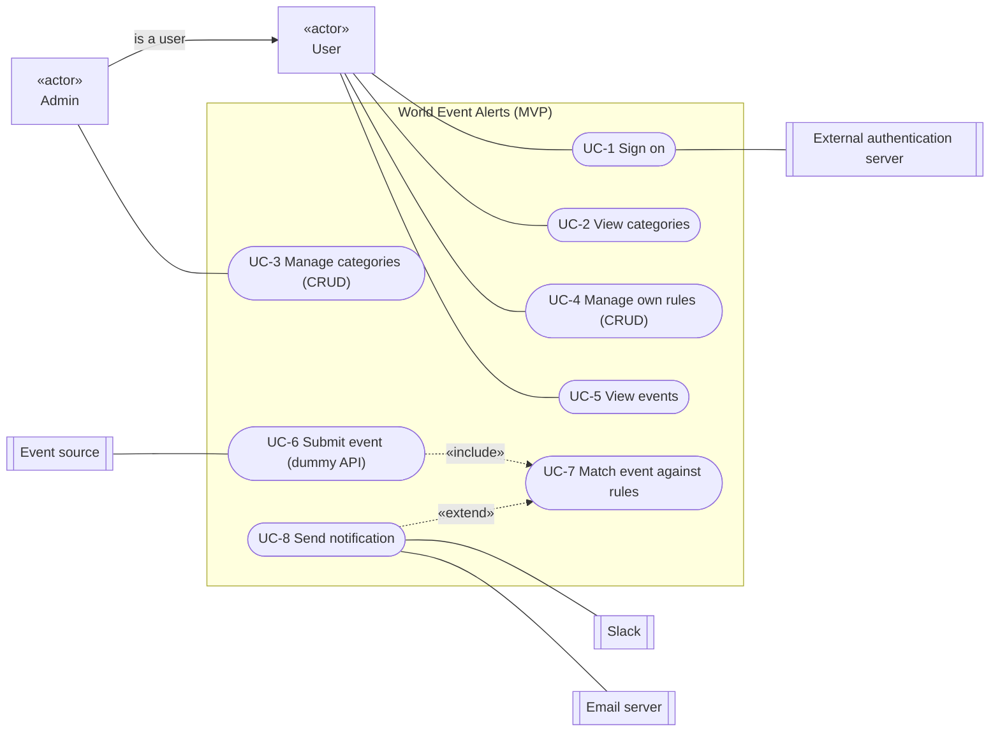

# 01 – Requirements: World Event Alerts

> **Status:** Draft v2 (2026-11-17). MVP scope (§4) agreed.
> This document describes **what** the system must do and why. **How** it is built is in [02-architecture-plan.md](02-architecture-plan.md).

---

## 1. The brief (verbatim, the only input)

> "We want users to be able to set up alerts so they get notified when something important happens in the world – like breaking news, market movements, natural disasters, that kind of thing. Should work for both email and Slack. Make it flexible enough that we can add more channels later. We need an admin view too."

No further specification, wireframes or schema exist. Everything below is our interpretation and is open to challenge.

---

## 2. How the brief is read

| # | Requirement from the brief | How it is read |
|---|---|---|
| R1 | "users … set up alerts" | A signed-on user can create, edit, enable/disable and delete **alert rules** |
| R2 | "something important happens in the world" | The system **receives and stores events** (through a dummy API in the MVP); what is "important" is narrowed to keyword matching (§3) |
| R3 | "breaking news, market movements, natural disasters" | Event categories are **data, not code**; the MVP ships with two dummy categories (§3.1) |
| R4 | "get notified" | When an event matches a rule, a **notification** goes to the rule's destinations |
| R5 | "email and Slack" | Two working channels: email and Slack |
| R6 | "add more channels later" | Adding a new channel must not require changes to rules, matching or event handling |
| R7 | "admin view" | Covered by the management functions in §4.1 (categories, rules, events); no dedicated admin UI in the MVP |

---

## 3. What "important" means

The exact meaning of "important" is **unclear and out of scope for the MVP**. The system doesn't score, rank or classify events by importance.

For the MVP, an event is relevant to a user **only if its content contains at least one of the keywords defined in the user's alert rule**:

- The "relevant content" is the event's **title and summary**.
- Keywords are defined ahead of time in the alert rule by the user who owns it, not taken from a global list.
- Matching is plain text search.

This keeps the system out of editorial decisions. A real definition of importance (severity scoring, thresholds, trend detection) is a future extension (§4.2).

### 3.1 Event categories

The exact event categories the application should support are **currently undefined**. They are not hard-coded; they are **stored in the database** so new categories can be added without a code change or redeploy.

For the MVP and testing, the system ships with **two dummy categories**, seeded on first start:

| Code | Name | Description |
|---|---|---|
| `DUMMY_A` | Dummy category A | Placeholder category for testing |
| `DUMMY_B` | Dummy category B | Placeholder category for testing |

- A category has: a **unique code**, a display name, an optional description, and an active flag.
- Every event belongs to exactly one category.
- Categories are managed through CRUD (§4.1, function 1). How deletion works for a category still in use is to be defined later.

---

## 4. MVP scope

### 4.1 In scope

| # | Function | What it covers |
|---|---|---|
| 1 | **Category management** | Create, read, update and delete event categories. Seeded with two dummy categories for testing. |
| 2 | **Rule management** | Create, read, update and delete alert rules (keywords, categories, notification destinations). |
| 3 | **Event management** | Store and manage events. A **dummy API** simulates incoming events until a real source is defined. |
| 4 | **Rule matching** | Match each incoming event against the configured rules (keyword occurrence, §3). |
| 5 | **Notifications** | Notify matching rules' destinations through **Slack** and **email**. |
| 6 | **Authentication** | Users sign on through an **external authentication server**. The application doesn't manage users itself; it only identifies the signed-on user, so each rule has an owner. |

### 4.2 Out of scope

- User management inside the application: registration, user administration, role management, password handling. All of this belongs to the external authentication server.
- Defining or measuring "importance" (severity, scoring, ranking)
- Defining the real event categories
- Real or simulated external event sources and polling
- Notification channels other than Slack and email (the design must allow adding them later)
- A dedicated admin UI, statistics, monitoring dashboards
- Notification extras: retries, rate limiting, digests, duplicate suppression, test notifications
- Rule extras: region/geo filtering, staleness windows
- Social login, multi-tenancy
- Scaling to multiple instances

---

## 5. Use cases

| ID | Use case | Actor(s) | MVP function (§4.1) |
|---|---|---|---|
| UC-1 | Sign on | User, Admin; external authentication server | 6 Authentication |
| UC-2 | View categories | User, Admin | 1 Category management |
| UC-3 | Manage categories (create, update, delete) | Admin | 1 Category management |
| UC-4 | Manage own rules (create, read, update, delete) | User, Admin | 2 Rule management |
| UC-5 | View events | User, Admin | 3 Event management |
| UC-6 | Submit event through the dummy API | Event source | 3 Event management |
| UC-7 | Match an event against the rules | System (always part of UC-6) | 4 Rule matching |
| UC-8 | Send notification via Slack or email | System; Slack, email server (only when UC-7 finds a match) | 5 Notifications |

Notes:
- **Admin** can do everything a **User** can, plus manage categories. Which user is an admin is decided in the external authentication server, not in the application.
- **Event source** is the caller of the dummy API. It stands in for a future real source, so replacing it doesn't change the use cases.
- Diagram notation: Mermaid has no native use case diagram, so this is a flowchart in use case style (rounded = use case, double-bordered = external system).
