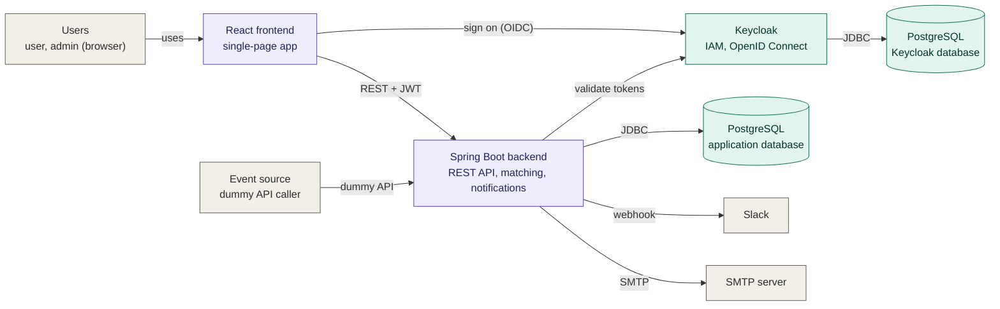

# Architecture Plan

## 1. Context Diagram

Purple = built by us · green = infrastructure we run · gray = users and external systems.

| Element | Responsibility |
|---|---|
| **React frontend** | Web application for users and admins. Sends the user to Keycloak to sign on, then calls the backend with the access token (JWT). |
| **Spring Boot backend** | REST API for categories, rules and events; the dummy event API; rule matching; sending notifications. Checks every request's token against Keycloak; never handles passwords. |
| **Keycloak** | External authentication server (IAM): users, sign-on, roles (user, admin). |
| **PostgreSQL – application database** | Categories, rules, events and notification results. Only the backend accesses it. |
| **PostgreSQL – Keycloak database** | Keycloak's own data (users, sessions, settings). A **separate database**, kept apart from the application data. |
| **Event source** | Calls the dummy API to simulate incoming events; stands in for a future real source. |
| **Slack / SMTP server** | Receive notifications from the backend. The frontend never talks to them. |

## 2. Domain Model

## 3. API Design

## 4. Technology
