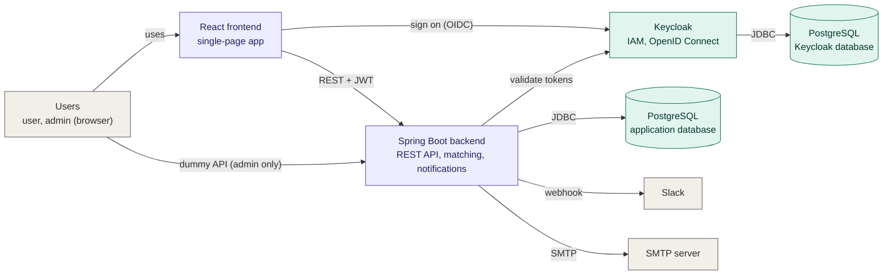
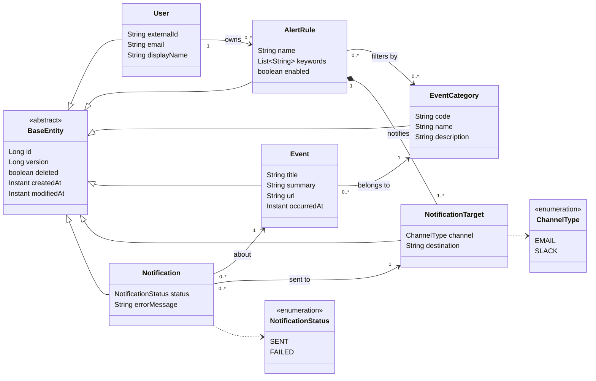

# Architecture Plan

## 1. Context Diagram

Purple = built by us · green = infrastructure we run · gray = users and external systems.

| Element | Responsibility |
|---|---|
| **React frontend** | Web application for users and admins. Sends the user to Keycloak to sign on, then calls the backend with the access token (JWT). |
| **Spring Boot backend** | REST API for categories, rules and events; the dummy event API (used by admins to simulate incoming events; stands in for a future real source); rule matching; sending notifications. Checks every request's token against Keycloak; never handles passwords. |
| **Keycloak** | External authentication server (IAM): users, sign-on, roles (user, admin). |
| **PostgreSQL – application database** | Categories, rules, events and notification results. Only the backend accesses it. |
| **PostgreSQL – Keycloak database** | Keycloak's own data (users, sessions, settings). A **separate database**, kept apart from the application data. |
| **Slack / SMTP server** | Receive notifications from the backend. The frontend never talks to them. |

## 2. Domain Model

This is the business view of the data, not the database tables. Types such as `Long` and `Instant` are only indications. Table design (link tables, how keywords are stored) follows during implementation.

### 2.1 Common fields

Every entity has the same five common fields, shown once in the diagram as `BaseEntity`:

| Field | Purpose |
|---|---|
| `id` (`Long`) | Primary key, generated by the database |
| `version` (`Long`) | Optimistic locking: an update based on an outdated copy is rejected instead of silently overwriting someone else's change |
| `deleted` (`boolean`) | **Logical deletion**: deleting sets this flag; the row is kept |
| `createdAt` (`Instant`) | When the record was created |
| `modifiedAt` (`Instant`) | When the record was last changed |

**Logical deletion** applies to every entity:
- Deleted records are hidden from normal lists and lookups, and can't be used in new references (e.g., a deleted category can't be chosen for a new event or rule).
- Existing references stay valid, so history remains readable (old events keep their category; notifications keep their target).
- Deleting a rule also marks its notification targets as deleted.
- A rule that filters only on deleted categories no longer matches anything. That follows from the matching rules; it isn't a special case.
- No restore in the MVP.

### 2.2 Entities

| Entity | Purpose | Own fields |
|---|---|---|
| **User** | A **local reference** to a person who signed on through the external authentication server (Keycloak). Not user management: the record is created automatically on first sign-on and never edited in the application. It exists so rules have an owner and can show a name instead of an ID. | `externalId` (Keycloak user ID), `email`, `displayName` |
| **EventCategory** | Groups events. Stored as data so admins can add new categories; two dummy categories are seeded. Named `EventCategory` rather than `Category` so other kinds of categories can be added later without a name clash. | unique `code`, `name`, `description` |
| **Event** | Something that happened, received through the dummy API. Not changed after it's stored. | `category`, `title`, `summary`, `url`, `occurredAt` |
| **AlertRule** | A user's definition of what they want to be notified about: keywords, plus optionally which categories. | `owner`, `name`, `keywords` (at least one), `categories` (empty = any), `enabled` |
| **NotificationTarget** | Where a rule sends its alerts: one channel plus one address. Belongs to exactly one rule. | `channel` (`EMAIL` / `SLACK`), `destination` (email address or Slack webhook URL) |
| **Notification** | The record of one send attempt and its result (completion criterion 4). `createdAt` is the time of the attempt. | `event`, `target`, `status` (`SENT` / `FAILED`), `errorMessage` |

### 2.3 Diagram

### 2.4 Relationships

| Relationship | Cardinality | Notes |
|---|---|---|
| User → AlertRule | 1 to 0..* | A user owns their rules and only sees and changes their own. |
| AlertRule → EventCategory | 0..* to 0..* | Optional filter; a rule with no categories matches events of any non-deleted category. |
| AlertRule → NotificationTarget | 1 to 1..* | Composition: targets belong to the rule and are (logically) deleted with it. |
| Event → EventCategory | 0..* to 1 | Every event has exactly one category. |
| Notification → Event, NotificationTarget | 0..* to 1 each | One record per send attempt. The rule can be reached through the target. |

## 3. API Design

REST with JSON, under the base path `/api`. The full endpoint list and request/response fields come from the generated OpenAPI documentation during implementation. This section only fixes the resources and the rules that apply to all of them.

### 3.1 Resources

| Resource | Operations | Who | Covers |
|---|---|---|---|
| `/api/categories` | list, view | User, Admin | UC-2 |
| `/api/categories` | create, update, delete | Admin | UC-3, criterion 2 |
| `/api/rules` | list, view, create, update, delete own rules | User, Admin | UC-4, criterion 1 |
| `/api/rules` | list and view **all** users' rules (read only) | Admin | UC-9 |
| `/api/events` | list, view | User, Admin | UC-5, criterion 3 |
| `/api/simulation/events` | submit an event (the dummy API) | Admin | UC-6, criterion 3 |
| `/api/me` | the signed-on user's own details | User, Admin | UC-1, criterion 5 |

Notification targets are **part of a rule**: they're sent and returned inside the rule, with no endpoint of their own (§2, composition). Matching (UC-7) and sending notifications (UC-8) have no endpoint: they start automatically after an event is stored.

### 3.2 Rules for all endpoints

- **Authentication:** every request needs a valid access token from Keycloak; the backend reads the user and role (`USER` / `ADMIN`) from it. The first request of a new user creates their local `User` record (§2).
- **Ownership:** users only see and change their own rules. Someone else's rule answers **404**, so the API doesn't even reveal that it exists. Admins can also *read* all rules, but change only their own.
- **Deletion** is logical (§2.1): `DELETE` sets `deleted`, and afterwards the record answers 404 and disappears from lists.
- **Concurrent changes:** updates carry the record's `version`. An outdated version is rejected with **409 Conflict**.
- **Errors** use one standard JSON error format (RFC 9457 "problem details"): 400 invalid input, 401 not signed on, 403 wrong role, 404 not found, 409 conflict.
- **Events list:** paged, newest first. It's the only list that can grow large.
- **Submitting an event** answers immediately once it's stored; matching and sending happen afterwards.
- **Slack webhook URLs** are secrets: responses show them masked (`https://hooks.slack.com/…/****`).

## 4. Technology
