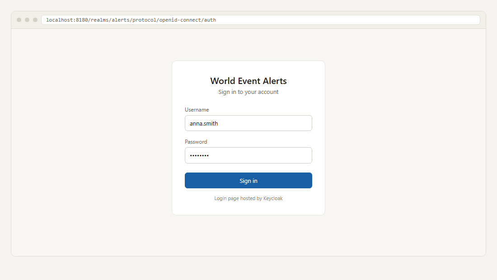
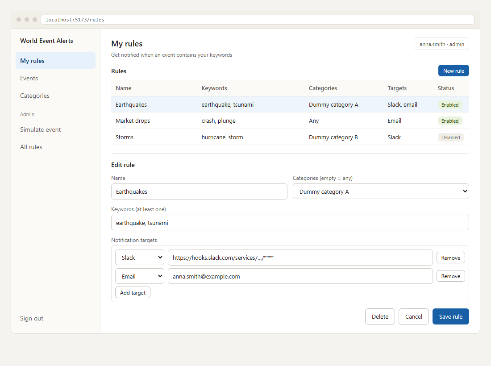
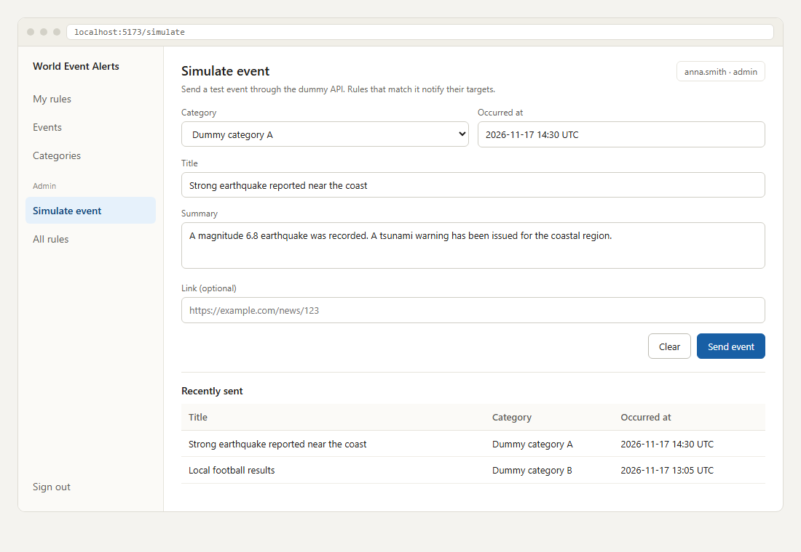

# UI Design

A simple design to give a general idea of what the application looks like. These are mockups, not final screens: colors, spacing and wording will change during implementation.

The images are generated from the HTML sources in [ui/](ui/), so they can be regenerated after a change.

---

## 1. Login page

- The login page is **Keycloak's own page**, not part of our application. Our app redirects the user there and receives a token after a successful sign-in, so it never handles passwords (requirements §4.1, function 6).
- It has a username field, a password field and a sign-in button. Keycloak's page can be styled to match the application.

---

## 2. Navigation menu and page layout

### Navigation menu

| Menu item | Who sees it | Page |
|---|---|---|
| My rules | User, Admin | Manage your own rules (UC-4) |
| Events | User, Admin | List of received events (UC-5) |
| Categories | User, Admin | View categories; admins can also create, edit and delete them (UC-2, UC-3) |
| Simulate event | Admin | Submit simulated events (UC-6) |
| All rules | Admin | Read-only list of every user's rules (UC-9) |
| Sign out | User, Admin | Signs out through Keycloak |

The **Admin** group is only shown to admins.

### Reusable page layout

Every page uses the same layout, shown here on the **My rules** page:

1. **Header:** page title, a short description, and the signed-on user.
2. **Table:** the page's records, with a "New …" button above it. Clicking a row loads it into the form.
3. **Form:** create or edit the selected record, with Save, Cancel and Delete.

The table columns and form fields depend on the page. On the rules page, notification targets are an add/remove list (channel + address per row), and Slack webhook URLs are shown masked. Read-only pages (Events, All rules, and Categories for users) show only the table.

---

## 3. Event simulation page

- **Admin only.** Sends an event through the dummy API (UC-6).
- Form fields: category, occurred at, title, summary, optional link.
- After sending, the event appears in the **Recently sent** table. Notification results aren't shown here; they can be checked in Slack and Mailpit.
