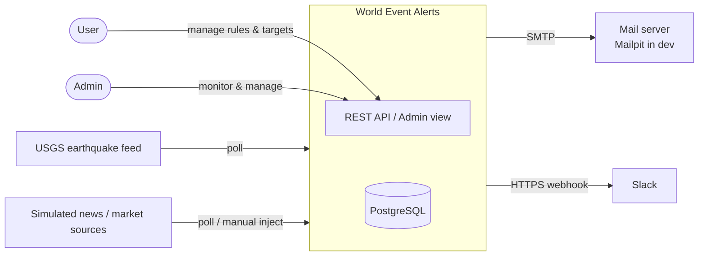
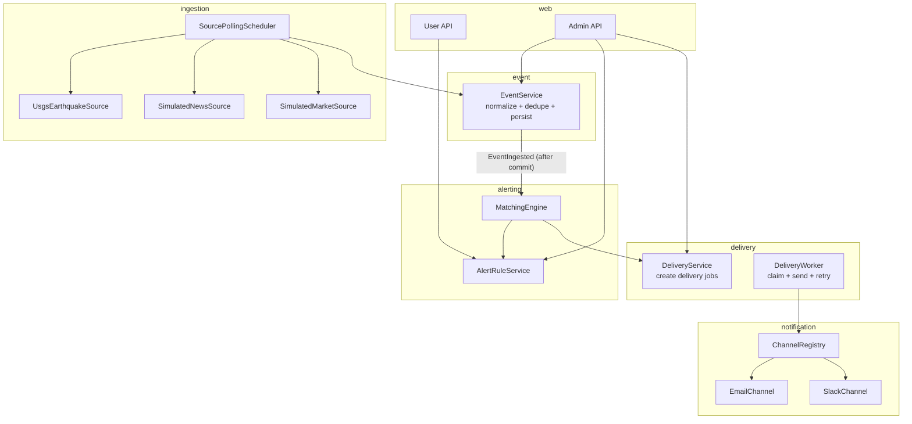
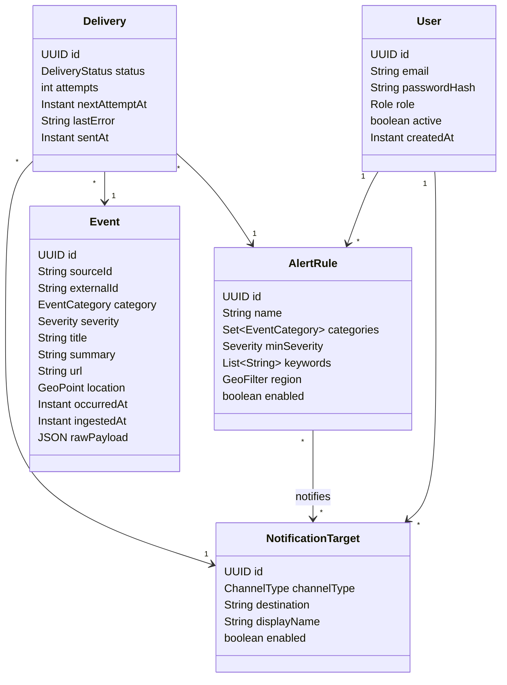
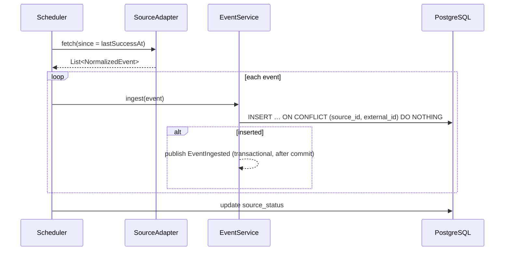
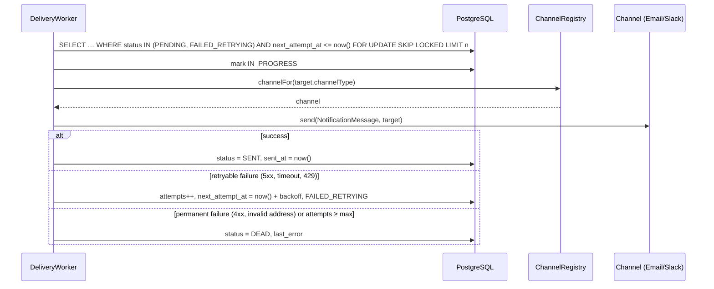

> **Superseded (2026-11-17).** Archived copy of the first AI-generated architecture plan, kept as an intermediate output. It reflects the earlier, larger scope (severity, user accounts, retries, USGS source) and does not match the current requirements in `01-requirements.md`.

# 02 – Architecture Plan: World Event Alerts

> **Status:** Draft v1 (2026-11-17). Written before any implementation.
> This document describes **how** the system is built. **What** it must do is in [01-requirements.md](01-requirements.md); requirement IDs (R*, FR-*, NFR-*, A*) refer to that document.
> Items marked **[VERIFY]** or **[DECISION]** still have to be confirmed.

---

## 1. Architectural style

**A modular monolith** – one Spring Boot application, split into packages with strict boundaries, one PostgreSQL database.

**Why:** 24-hour budget, one developer, and the brief's real extensibility need (R6 / NFR-3) is solved by *interfaces*, not by distributed deployment. Microservices would add network, deployment and consistency complexity without proving anything the brief asks for. Module boundaries are kept clean so a module (e.g., delivery) could be extracted later. → **ADR-01**

### 1.1 Context diagram



### 1.2 Component / module diagram



### 1.3 Module responsibilities and dependency rules

| Module | Responsibility | May depend on |
|---|---|---|
| `ingestion` | Fetch from external sources, map to `NormalizedEvent` (incl. severity mapping, requirements §3.2) | `event` |
| `event` | Persist events, deduplicate, publish `EventIngested` | `common` |
| `alerting` | Rule CRUD, matching logic | `event` (read), `user` |
| `delivery` | Delivery jobs, worker, retries, rate cap, history | `notification`, `alerting` (read) |
| `notification` | Channel SPI and implementations, message rendering | `common` only |
| `user` | Accounts, roles, auth | `common` |
| `web` | REST controllers, DTOs, exception handling | all service APIs |
| `common` | Shared value types, clock, errors | — |

Rule: **`notification` knows nothing about rules or events** – it receives a channel-agnostic `NotificationMessage`. That keeps channels reusable and easy to test. Enforced by an ArchUnit test.

---

## 2. Domain model



### Key enums
- `EventCategory`: `NATURAL_DISASTER`, `MARKET`, `NEWS` (requirements §3.1)
- `Severity`: `LOW(1)`, `MEDIUM(2)`, `HIGH(3)`, `CRITICAL(4)`
- `ChannelType`: `EMAIL`, `SLACK` – stored as a **string**, not an ordinal, so adding channels never breaks existing data
- `DeliveryStatus`: `PENDING`, `IN_PROGRESS`, `SENT`, `FAILED_RETRYING`, `DEAD`

---

## 3. Data model (PostgreSQL, Flyway-managed)

| Table | Key columns | Constraints / indexes |
|---|---|---|
| `app_user` | id, email, password_hash, role, active, created_at | `UNIQUE(email)` |
| `notification_target` | id, user_id, channel_type, destination, display_name, enabled | FK user; destination is **sensitive** (NFR-5) |
| `alert_rule` | id, user_id, name, categories (text[]), min_severity, keywords (text[]), region (jsonb), enabled, created_at, updated_at | FK user; index (enabled) |
| `alert_rule_target` | rule_id, target_id | PK(rule_id, target_id); target must belong to the same user (checked in service) |
| `event` | id, source_id, external_id, category, severity, title, summary, url, lat, lon, occurred_at, ingested_at, matched_at, raw_payload (jsonb) | **`UNIQUE(source_id, external_id)`** → dedup (FR-5.1); index (occurred_at); partial index where matched_at is null |
| `delivery` | id, event_id, rule_id, target_id, status, attempts, next_attempt_at, last_error, created_at, sent_at | **`UNIQUE(event_id, target_id)`** → FR-5.4; partial index on (next_attempt_at) where status in (PENDING, FAILED_RETRYING) |
| `source_status` | source_id, last_run_at, last_success_at, last_error, events_last_run | FR-6.6 |

> `rule_id` on `delivery` records the first rule that matched, for history and admin views. The uniqueness is on (event, target), per D007.

---

## 4. Key flows

### 4.1 Ingestion



- Each source has its own schedule (`alerts.sources.usgs.poll-interval=PT1M`).
- One failing source must **not** stop the others (FR-5.2): try/catch per source, error recorded in `source_status`.
- Adapters are pure: HTTP fetch + mapping, easy to test against recorded fixtures.

### 4.2 Matching → delivery job creation
- `@TransactionalEventListener(phase = AFTER_COMMIT)` receives `EventIngested`.
- `MatchingEngine` loads enabled rules of active users **pre-filtered in SQL** by category and severity, then applies the keyword, region and staleness filters in memory (requirements §6.4).
- For each (match, target): `INSERT INTO delivery … ON CONFLICT DO NOTHING` with status `PENDING`; then `event.matched_at` is set.
- Known gap: if the app crashes between event commit and the listener, the matching is lost. **Fix:** a periodic "rematch" sweep over events with `matched_at IS NULL`. This gives at-least-once matching without a broker (NFR-2). → **ADR-02**

### 4.3 Delivery worker



- Backoff: exponential with jitter (e.g., 30 s, 2 m, 8 m, 32 m, max 5 attempts) – FR-5.5.
- Hourly cap per target (FR-5.6): checked before sending by counting `SENT` rows for the target in the last hour; over the cap → rescheduled, not dropped.
- Stuck `IN_PROGRESS` rows (worker crash) are reset after a lease timeout.
- Delivery is **at-least-once**: a crash after a successful send but before the DB update may re-send. That's acceptable and documented (NFR-2); exactly-once to Slack/SMTP isn't achievable without receiver-side idempotency.

### 4.4 Safe for multiple instances
`FOR UPDATE SKIP LOCKED` lets several workers share the queue. The source-polling schedulers would need a lock if more than one instance runs (ShedLock). The MVP runs one instance (A4); ShedLock is the upgrade path.

---

## 5. Extensibility – the channel and source SPIs (R6 / NFR-3)

```java
public interface NotificationChannel {
    ChannelType type();                                  // e.g. EMAIL
    void validateDestination(String destination);        // FR-2.2, called on target create/update
    SendResult send(NotificationMessage message, String destination);
}

public sealed interface SendResult {
    record Success() implements SendResult {}
    record RetryableFailure(String reason) implements SendResult {}
    record PermanentFailure(String reason) implements SendResult {}
}
```

- `ChannelRegistry` collects all `NotificationChannel` beans from Spring at startup (`Map<ChannelType, NotificationChannel>`) and fails fast on duplicates or on a `ChannelType` with no implementation.
- **Adding a channel (e.g., Microsoft Teams, SMS)** = implement the interface + add an enum value + config. No changes to rules, matching or delivery. The README will show a worked example (likely a third, minimal `WebhookChannel` or `LogChannel`, proving the claim).
- `ChannelType` modeling: closed enum for the MVP vs. an open string-backed type **[DECISION – D008]**.
- Message rendering: a `NotificationMessage` (title, body, severity, url, category) is channel-agnostic; each channel formats it (plain/HTML email, Slack text or Block Kit).

The **event source SPI** follows the same pattern:

```java
public interface EventSource {
    String id();                                   // "usgs-earthquakes"
    List<NormalizedEvent> fetch(Instant since);
}
```

---

## 6. API design

### User API (`ROLE_USER`)
| Method | Path | Purpose | Req. |
|---|---|---|---|
| POST | `/api/auth/register` | Register | FR-1.1 |
| GET/POST | `/api/targets` | List / create notification targets | FR-2.1 |
| PUT/DELETE | `/api/targets/{id}` | Update / delete target | FR-2.1 |
| POST | `/api/targets/{id}/test` | Send a test notification | FR-2.3 |
| GET/POST | `/api/rules` | List / create alert rules | FR-3.1 |
| GET/PUT/DELETE | `/api/rules/{id}` | Rule details / update / delete | FR-3.1 |
| GET | `/api/me/deliveries` | My notification history | FR-5.7 |

### Admin API (`ROLE_ADMIN`)
| Method | Path | Purpose | Req. |
|---|---|---|---|
| GET | `/api/admin/users` | List users | FR-6.1 |
| POST | `/api/admin/users/{id}/deactivate` | Deactivate a user | FR-1.3 |
| GET | `/api/admin/rules` | All rules, filterable | FR-6.2 |
| GET | `/api/admin/events` | Ingested events, filterable | FR-6.3 |
| POST | `/api/admin/events` | Manually inject an event | FR-6.4 |
| GET | `/api/admin/deliveries` | Delivery log, filterable | FR-6.5 |
| POST | `/api/admin/deliveries/{id}/retry` | Re-queue a DEAD delivery | FR-6.5 |
| GET | `/api/admin/sources` | Source health | FR-6.6 |
| GET | `/api/admin/stats` | Counts by day / status / channel | FR-6.7 |

Conventions: JSON, `ProblemDetail` (RFC 9457) errors, pagination on list endpoints, OpenAPI via springdoc, Bean Validation on every request DTO.

---

## 7. Cross-cutting implementation

| Concern | Approach | Req. |
|---|---|---|
| Authentication | Spring Security; HTTP Basic for the API in MVP **[DECISION – D009, alternative: JWT]**; BCrypt passwords | FR-1.1 |
| Authorization | Ownership check in the service layer for every user-scoped resource; negative tests per endpoint (IDOR) | NFR-4 |
| Secrets | Webhook URLs masked in API responses (`https://hooks.slack.com/…/****`), excluded from logs and `toString()`; SMTP credentials from env vars | NFR-5 |
| SSRF | `SlackChannel.validateDestination` enforces the `https://hooks.slack.com/` prefix | NFR-6 |
| Observability | Structured logs with event/delivery IDs; Spring Boot Actuator health (DB, mail); Micrometer counters | NFR-7 |
| Time | `Instant` / `timestamptz` in UTC; an injected `Clock` bean so tests can control time | NFR-10 |
| Config | `@ConfigurationProperties` per module, validated at startup | NFR-8 |
| Resilience | Explicit connect/read timeouts on every outbound HTTP call (feeds + Slack) | FR-5.2 |

---

## 8. Technology choices (proposed – to be confirmed)

| Concern | Choice | Notes |
|---|---|---|
| Language / runtime | **Java 21** | Records, sealed interfaces, pattern matching, virtual threads available |
| Framework | **Spring Boot 3.x** (latest stable) **[VERIFY exact version at project init]** | Web, Data JPA, Validation, Security, Mail, Actuator |
| Build | **Maven** (wrapper committed) | Gradle is equally fine; Maven is the more common choice in enterprise reviews |
| Database | **PostgreSQL 16** | `SKIP LOCKED`, jsonb, arrays |
| Migrations | **Flyway** | Schema is reviewed SQL, not Hibernate `ddl-auto` |
| HTTP client | Spring `RestClient` | With explicit timeouts |
| Email (dev) | **Mailpit** in Docker | Web UI to show received mails in screenshots |
| API docs | springdoc-openapi | Swagger UI for the reviewer |
| Testing | JUnit 5, AssertJ, Mockito, **Testcontainers** (Postgres), **WireMock** (USGS + Slack), GreenMail or Mailpit for SMTP, **ArchUnit** for module rules | |
| Admin view | REST API first; Thymeleaf page only if time allows (D011) | |
| Local runtime | Docker Compose: app + Postgres + Mailpit | NFR-8 |

---

## 9. Package structure (planned)

```
com.example.alerts
├── AlertsApplication.java
├── common/          (Severity, EventCategory, Clock config, errors)
├── user/            (User, UserRepository, UserService, security config)
├── event/           (Event, EventRepository, EventService, EventIngested)
├── ingestion/
│   ├── EventSource.java, SourcePollingScheduler.java
│   ├── usgs/        (UsgsEarthquakeSource, DTOs, mapper)
│   └── simulated/   (SimulatedNewsSource, SimulatedMarketSource)
├── alerting/        (AlertRule, AlertRuleService, MatchingEngine)
├── delivery/        (Delivery, DeliveryService, DeliveryWorker, BackoffPolicy)
├── notification/
│   ├── NotificationChannel.java, ChannelRegistry.java, NotificationMessage.java
│   ├── email/       (EmailChannel)
│   └── slack/       (SlackChannel)
└── web/
    ├── user/        (controllers + DTOs)
    └── admin/       (controllers + DTOs)
```

---

## 10. Testing strategy

| Level | What | Tools |
|---|---|---|
| Unit | `MatchingEngine` (truth table for every criterion in requirements §6.4 and their combination), severity mappers, `BackoffPolicy`, USGS mapper against a **recorded real fixture** | JUnit, AssertJ |
| Slice | Controllers (validation, auth, IDOR), repositories (dedup constraint, `SKIP LOCKED` query) | `@WebMvcTest`, `@DataJpaTest` + Testcontainers |
| Integration | Full flow: stubbed USGS feed → event stored → rule matched → Slack stub receives POST & SMTP receives mail; retry on Slack 500; DEAD after max attempts; no duplicate on re-poll | `@SpringBootTest` + Testcontainers + WireMock |
| Architecture | Module dependency rules from §1.3 | ArchUnit |
| Manual / demo | Docker Compose up → create rule → inject event → screenshot of Mailpit + Slack | Screenshots in `docs/notes/` |

**Definition of done for each milestone:** builds clean, tests green, logs updated, commit with a meaningful message.

---

## 11. Validation checkpoints for AI-generated output

The evaluation focuses on how AI output was checked. Each of these is a planned, explicit check, and its result goes into `docs/notes/`:

1. **External API contracts:** fetch the real USGS feed once, save it as a fixture, and compare it field by field against the generated DTOs (A5). Don't trust field names the AI produced from memory.
2. **Slack webhook contract:** check it against Slack's official docs (A6); test once against a real webhook if one is available.
3. **Dependency versions:** check every version in `pom.xml` against Maven Central / Spring Initializr. Hallucinated or outdated versions are a known AI failure mode.
4. **SQL and concurrency:** review the `SKIP LOCKED` claim query and the `ON CONFLICT` statements by hand, and prove them with a Testcontainers test (two workers, no double send).
5. **Transaction boundaries:** confirm `@TransactionalEventListener` really fires after commit (test with rollback).
6. **Security:** a negative test for every user-scoped endpoint; check that webhook URLs never show up in logs or responses.
7. **Matching semantics:** each rule in requirements §6.4 has a test; look specifically for the AI "simplifying" AND-logic into OR-logic, or dropping case-insensitivity.
8. **Scope creep:** reject generated code that adds features outside requirements §4.1 (e.g., Kafka, OAuth) without a decision log entry.

---

## 12. Risks

| Risk | Likelihood | Mitigation |
|---|---|---|
| USGS feed shape differs from assumption | Medium | Recorded fixture + mapper test (§11.1) |
| No real Slack workspace for the demo | Medium | WireMock proves the contract; real-send screenshot if possible |
| Time overrun on the admin UI | High | REST-first; UI is optional |
| Notification floods (backfill, noisy source) | Medium | Staleness window + per-target cap |
| AI-generated code looks right but is subtly wrong (transactions, concurrency) | High | Checkpoints §11.4–11.5 |

---

## 13. Milestones (each = one commit or more)

| # | Milestone | Exit criteria |
|---|---|---|
| M0 | Repo + process docs | ✅ `.gitignore`, `docs/` |
| M1 | Requirements and architecture reviewed | Open decisions in both documents resolved |
| M2 | Walking skeleton | Boot app + Postgres + Flyway + Compose start; health endpoint green; `mvn verify` passes |
| M3 | Domain + persistence | Entities, migrations, repositories, dedup constraints tested |
| M4 | Ingestion | USGS adapter with fixture test; simulated sources; source health |
| M5 | Rules + matching | Rule CRUD API with auth; matching engine fully unit-tested |
| M6 | Delivery + channels | Worker, retries, email + Slack; end-to-end integration test |
| M7 | Admin API (+ optional UI) | Endpoints in §6 with tests |
| M8 | Hardening & review | AI-output review pass documented; security tests; ArchUnit |
| M9 | README + reflection | How to run, demo script, known gaps, what's next |

---

## 14. Open architecture decisions

| ID | Question | Recommendation |
|---|---|---|
| D003 | Stack confirmation | Java 21 + Spring Boot 3 + PostgreSQL + Maven |
| D004 | Architecture style | Modular monolith (ADR-01) |
| D005 | Work queue | DB-backed (`SKIP LOCKED`) + rematch sweep instead of a message broker (ADR-02) |
| D008 | `ChannelType` modeling | Closed enum for MVP, stored as string |
| D009 | API authentication | HTTP Basic for MVP |

Requirement-level decisions (D006, D007, D010, D011) are listed in [01-requirements.md §8](01-requirements.md#8-open-requirement-decisions).
